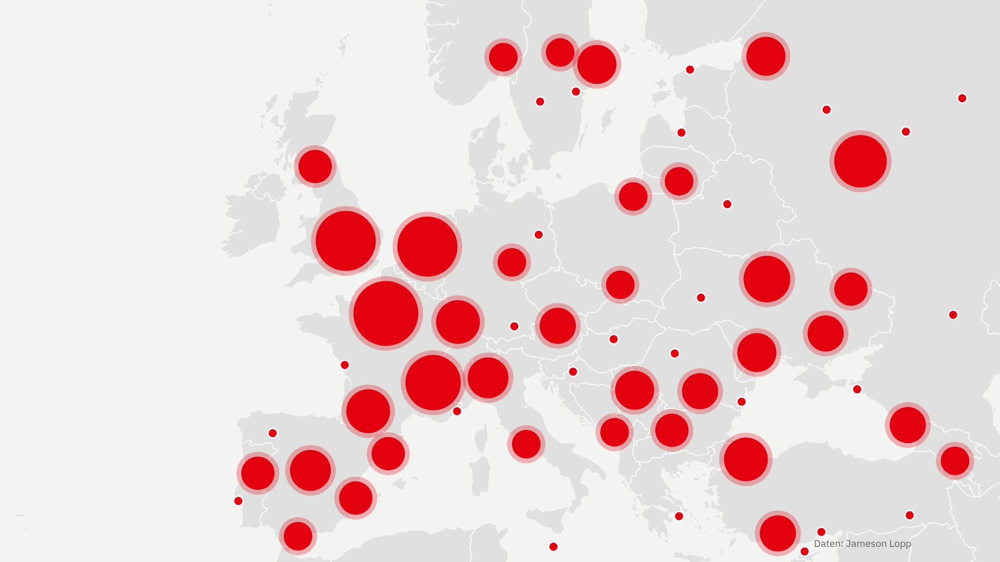
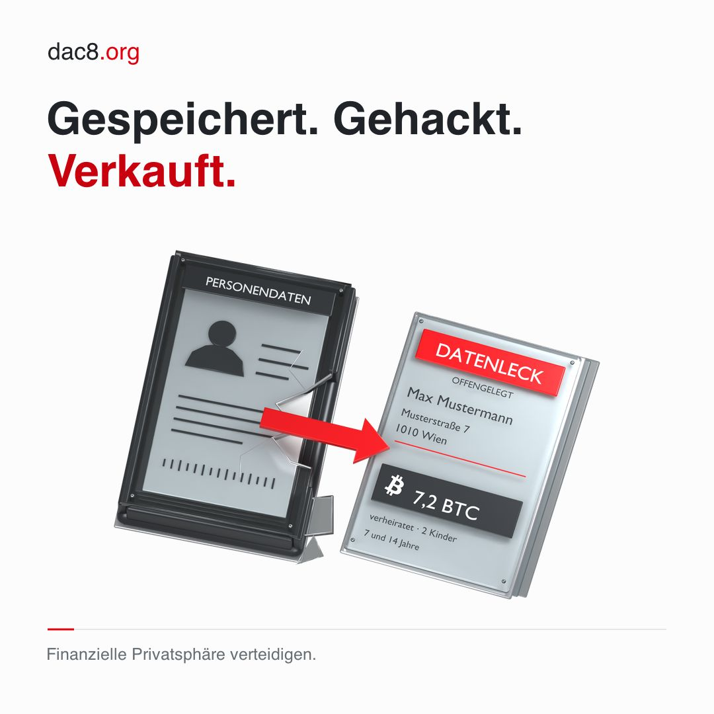
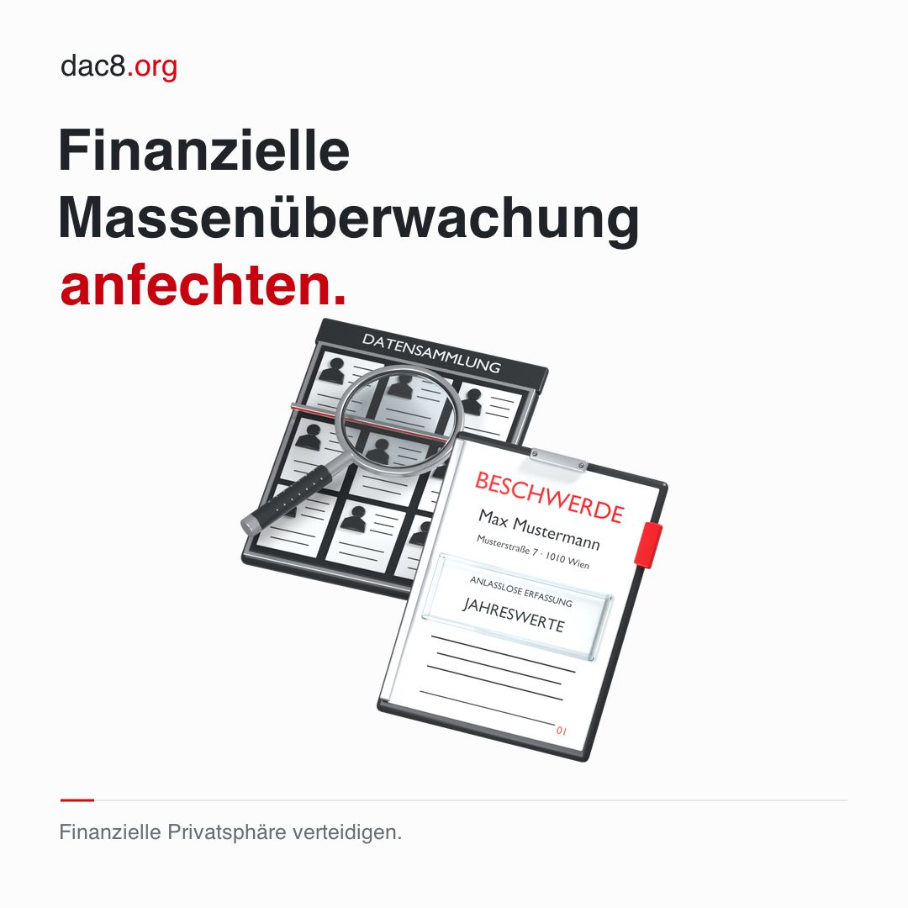
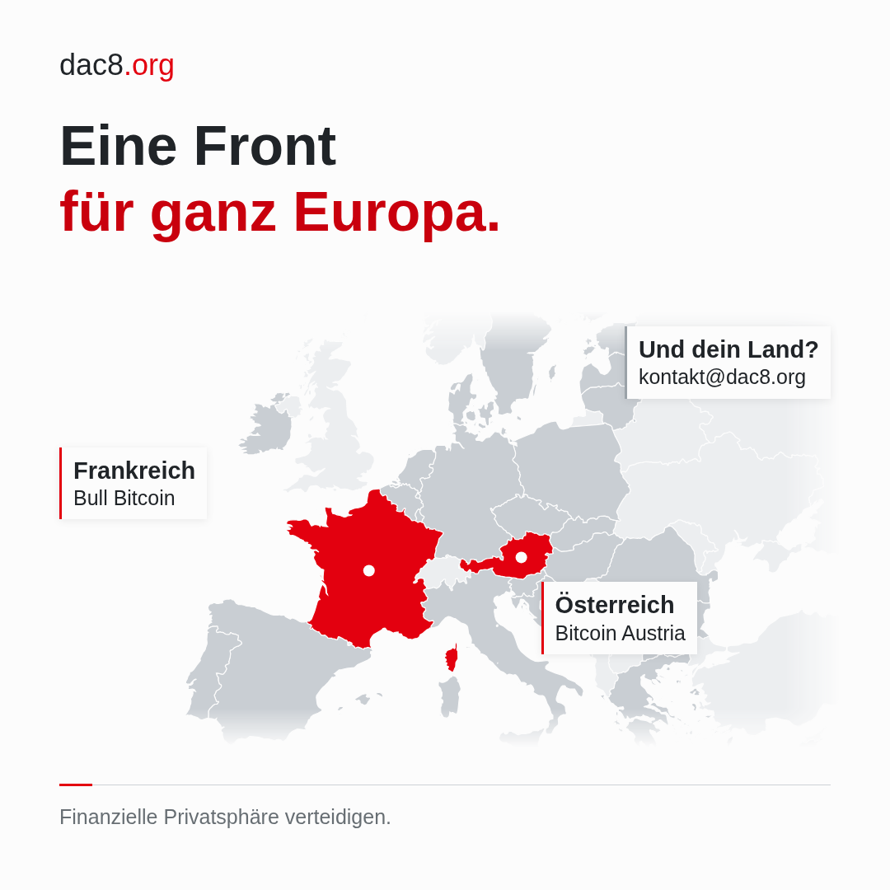

# X-Thread zum Start (Deutsch)

Ab 2. November 2026, 10:00 Uhr (Embargo). Jeder Post bleibt unter 280 Zeichen
(geprüft mit `xlen.py`, Links zählen 23). Medien im Ordner `media/`; die Karte
in Post 2 ist 16:9, alles andere 1:1. Post 7 hat kein Bild, damit die
Linkvorschau erscheint.

---

**1/7** · Medien: [media/01-datenweg.mp4](media/01-datenweg.mp4) (Film „Was mit deinen Daten passiert“ mit großen Untertiteln, 20 s)

```text
Ab 2027 melden Börsen, Broker und Krypto-Apps dem Finanzamt jedes Jahr, wer bei ihnen Krypto kauft: Name, Steuernummer, Beträge. Gesammelt wird seit Jänner. Ohne Verdacht.

So entsteht eine Liste von Krypto-Besitzern samt Wohnadresse.

Wir gehen dagegen vor.
```

**2/7** · Medien: [media/02-angriffe-karte.jpg](media/02-angriffe-karte.jpg) (Karte der bekannten Angriffe wie auf dac8.org, ohne Zahlen, Stand 2. November 2026)



```text
Warum das gefährlich ist: Bitcoin ist wie Bargeld. Wer weiß, wie viel Krypto jemand besitzt und wo er wohnt, kann ihn gezielt überfallen.

In Europa sind 275 Angriffe auf Krypto-Besitzer bekannt. Allein Frankreich zählte heuer bis Juni 77 Entführungen und Erpressungen.
```

**3/7** · Medien: [media/03-datenleck.jpg](media/03-datenleck.jpg) (Share-Kit „Gespeichert. Gehackt. Verkauft.“)



```text
Solche Daten geraten oft in falsche Hände. Anbieter, Steuertools und Behörden haben schon Daten von rund 46 Millionen Menschen verloren.

Dein Anbieter speichert deinen Ausweis, Wallet-Adressen und jede Transaktion, bis zu zehn Jahre, nachdem du kein Kunde mehr bist.
```

**4/7** · Medien: [media/04-anfechten.jpg](media/04-anfechten.jpg) (Share-Kit „Finanzielle Massenüberwachung anfechten.“)



```text
Darum starten wir dac8.org: eine Initiative von Bitcoin Austria, unterstützt von Coinfinity.

Dr. Oliver Völkel (CERHA HEMPEL) hat im Oktober Beschwerde bei der Datenschutzbehörde eingebracht. Das Ziel: VfGH und EuGH sollen klären, ob DAC8 Grundrechte verletzt.
```

**5/7** · Medien: [media/05-ausweis.mp4](media/05-ausweis.mp4) (Film: Ausweisgrenze 1991 und 2027, in Gold, Krypto ab dem ersten Cent, dann die Regeln 1977 bis 2026, mit großen Untertiteln, 20 s)

```text
1991 musste man sich bei einem Bargeschäft ohne Konto erst ab 15.000 ECU ausweisen. Das waren 47 Unzen Gold, heute wären es 33.900 €. Ab Juli 2027 gilt: 10.000 €, bar schon ab 3.000 €.

Bei Krypto-Anbietern gibt es gar keine Grenze. Identitätsprüfung ab dem ersten Cent.
```

**6/7** · Medien: [media/06-europa.png](media/06-europa.png) (Karte „Eine Front für ganz Europa“)



```text
Angestoßen hat das alles @BullBitcoin_. Seit Februar klagt es in Frankreich gegen die Umsetzung von DAC8.

„Das Einzige, was ich garantieren kann: Wir werden niemals aufgeben.“ @francispouliot_

Wir ziehen in Österreich nach.

DAC8 im eigenen Land anfechten? kontakt@dac8.org
```

**7/7** · ohne Bild: X zeigt dann die Linkvorschau von dac8.org/spenden

```text
Privatsphäre muss niemand begründen. Aber jemand muss sie verteidigen.

Ein Verfahren durch die Instanzen dauert Jahre und kostet Geld. Deine Spende bezahlt vor allem dieses Verfahren. Mit Bitcoin geht das auch ohne Name und E-Mail.

dac8.org/spenden
```

---

## Vor dem Posten prüfen

- X-Handles `@BullBitcoin_` und `@francispouliot_` bestätigen. Das Zitat in
  Post 6 ist übersetzt aus Pouliots Manifest auf dac8.com/en/manifesto.
  Coinfinity steht ohne Handle drin; mit Handle verlinken, wenn Coinfinity
  das möchte.
- Post 2: Die Daten der Karte stammen aus der Liste von Jameson Lopp; der
  Nachweis steht im Bild. Die 275 sind die Zahl, die dac8.org am 2. November
  2026 für Europa nennt; ändert sie sich bis zum Posten, anpassen.
- Post 1 als Erstes anheften.
- `media/reserve/` enthält die zwei Medien, die im gekürzten Thread nicht mehr
  vorkommen (`jahresmeldung.png`, `meldungen.mp4`), etwa für Antworten.
